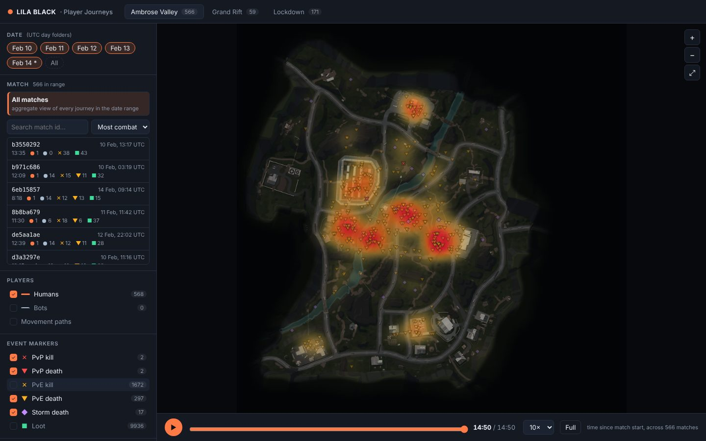
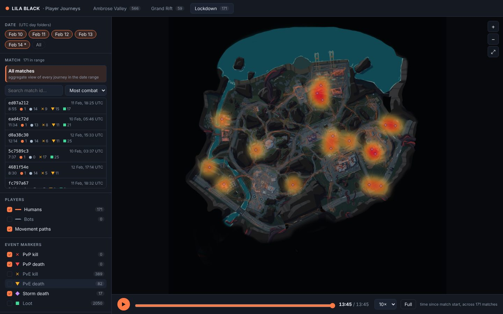

# Three things I learned about LILA BLACK

All numbers come from the processed data in `web/public/data`, and you can reproduce each view in the tool with the filters named in each section. "Human deaths" means journeys classified as human (see ARCHITECTURE.md).

---

## 1. Ambrose Valley's centre is a meat grinder: 21% of the map, 72% of the deaths

**What caught my eye.** With *Death zones* on, bots hidden and only human deaths showing, Ambrose Valley lights up in a tight ring. It runs from the walled compound, across the river crossings, to the large warehouse block east of it. The rest of the map barely registers.

**The evidence.** I took a box around that core (world x −148…147, z −108…107):

| | Inside the central box | Whole map |
|---|---|---|
| Share of playable area | **21%** | 100% |
| Human movement samples | 33% | 100% |
| Human loot pickups | 34% | 100% |
| Human kills on bots | 62% | 100% |
| **Human deaths to bots** | **72%** (215 of 297) | 100% |
| Deaths per 1,000 movement samples | **18.3** | 3.4 outside the box |

Time spent in the centre is **5.4× deadlier** than time spent anywhere else on the map. Loot there isn't richer per visit, though: the centre's loot share (34%) matches its traffic share (33%).

**Actionable?** Yes. The centre carries all the risk of a hot zone but gives no matching reward.
- Either raise the reward (higher-tier loot or an objective in the compound or warehouse) so the risk is a choice, or thin out bot density and patrol overlap around the river crossings so it stops being an unavoidable kill box.
- Add cover and alternate routes across the river. The deaths cluster on the approaches, not inside buildings.
- Metrics to watch: deaths per 1,000 samples inside vs outside the box (target well under 5×), human survival rate on Ambrose (44% now), median time-to-first-death (4:30 now), and loot per journey.

**Why a level designer should care.** Players are funnelled through this area. When most deaths happen in one fifth of the map, a run's outcome is decided by one route choice through the centre, and the outer POIs become places to loot safely rather than to fight over. Small changes to cover, sightlines or bot patrols in this box will move the game's survival numbers more than changes anywhere else.

---

## 2. The storm only kills late, and on Lockdown it kills 3× more often

**What caught my eye.** Scrubbing the aggregate timeline with only *Storm death* markers on, nothing appears until about minute 11. Then storm deaths pop up all over the map interior, not at the edges.

**The evidence.**
- All **39** storm deaths in five days happen after **10:55** of match time (median 12:19). There is no early-storm death at all.
- Storm death rate per human journey: **Lockdown 9.9%** (17/171), **Grand Rift 8.5%** (5/59), **Ambrose Valley 3.0%** (17/568). Lockdown, the "small, close-quarters" map, kills 3.3× more players to the storm than the biggest map.
- On Lockdown, storm victims die spread across the central and eastern interior (the heatmap above), far from the edges. They weren't caught crossing a boundary; they were deep in the map when time ran out.

**Actionable?** Yes.
- On Lockdown, make extraction readable earlier: an audio or visual storm warning around 9–10 min, extraction markers visible from the central/eastern POIs, or an extra extraction on the east side where the storm deaths cluster.
- Check the storm speed against the walk time from the eastern POIs to the nearest extraction. On a dense map, routes are longer than the minimap distance suggests.
- Metrics: storm deaths per journey per map (aim to bring Lockdown towards Ambrose's 3%), share of journeys that extract, time between storm start and extraction.

**Why a level designer should care.** A storm death feels unfair when the player didn't know where to go. Deaths that cluster by map, rather than spreading evenly, point to a layout and signposting problem, not a skill problem.

---

## 3. It's an extraction shooter with almost no PvP: the maps are being tuned against bots

**What caught my eye.** Sorting matches by "Most players" and turning on PvP markers, the PvP counters stay at zero almost everywhere.

**The evidence.**
- **794 of 796 matches have exactly one human** (only 2 matches have two).
- In five days there are **3 PvP kills**, against **2,240 human→bot kills**.
- Of 445 human deaths, **403 (91%) are to bots**, 39 to the storm, and **3 to other players**.
- Bot telemetry exists for just 53 matches. In most matches the only record of bots is the human's own `BotKill`/`BotKilled` events.

**Actionable?** Yes, and it changes how to read every other heatmap.
- Treat the current combat heatmaps as a map of **bot placement and AI behaviour**, not of PvP sightlines. Before redesigning a chokepoint because of a death cluster, check whether bot spawns are what's driving it.
- For matchmaking/live ops: lobbies aren't filling with humans (or humans are split across too many instances). Metrics: humans per match, PvP encounters per match, time-to-first-human-contact.
- For level design: playtest PvP-critical spaces (extraction points, the Ambrose centre) in private multi-human lobbies, because this production data can't validate them.

**Why a level designer should care.** Extraction-shooter maps are built around player-vs-player tension: who holds the extraction point, who third-parties a fight. If that tension is absent in production, the "hot zones" in the data are hot because of bot tuning, and any layout change based on them needs that caveat.
