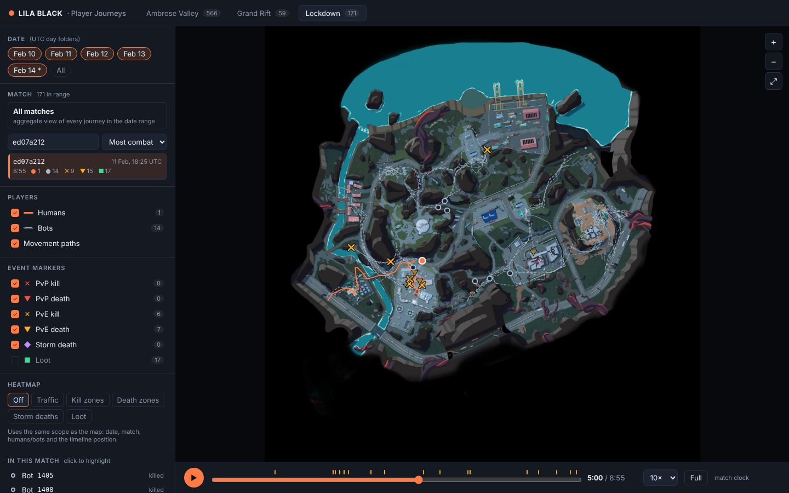

# LILA BLACK · Player Journey Visualizer

A browser tool for Level Designers to see how players actually move through, fight in, loot and die on the three LILA BLACK maps, built from 5 days of production telemetry (Feb 10–14, 2026; 1,243 journey files, ~89k events).




## What it does

| Feature | How to use it |
|---|---|
| Journeys on the right minimap | Pick **Ambrose Valley / Grand Rift / Lockdown** in the top bar. Paths are drawn from world `x`/`z`, mapped onto the minimap with each map's scale and origin. |
| Humans vs bots | Humans are solid coloured lines with a filled playhead. Bots are dashed grey-blue lines with a hollow playhead. Toggle each group under **Players**. |
| Event markers | Shape and colour both encode the type: ✕ kill, ▼ death, ◆ storm death, ■ loot. Red is PvP, amber is PvE (bot involved). Hover a marker for who, what, when and elevation. Click it to highlight that player. |
| Filters | **Date** chips (UTC day folders; Feb 14 is partial), a searchable and sortable **Match** list, or **All matches** for an aggregate view. Counts update with every filter. |
| Timeline / playback | Play, scrub, or change speed (1–25×). Ticks on the track mark kills and deaths. In a single match it's the match clock. In aggregate it's "time since match start", so you can watch where every match's storm deaths happen after minute 11. |
| Heatmaps | Traffic, kill zones, death zones, storm deaths, loot. Heatmaps follow the same scope as everything else (date, match, humans/bots, timeline). |
| Shareable views | The URL keeps the map, match and heatmap, so `?map=Lockdown&heat=storm` opens straight to that view. |
| Navigation | Scroll to zoom, drag to pan, ⤢ to re-fit. The bottom-right readout shows world coordinates under the cursor, so you can look a spot up in the editor. |

Answers to the brief: [ARCHITECTURE.md](ARCHITECTURE.md) (stack, data flow, coordinate mapping, assumptions, trade-offs) and [INSIGHTS.md](INSIGHTS.md) (three findings about the game).

## Tech stack

- **Data pipeline:** Python 3.10+, `pyarrow`, `pandas`, `numpy`, `Pillow`. Runs offline, once.
- **Frontend:** React 19 + TypeScript + Vite, rendered on a single HTML `<canvas>` (no chart library).
- **Tests:** Vitest (coordinate mapping against the README's worked example, heatmap binning).
- **Hosting:** any static host. Config is included for Vercel (`vercel.json`), Netlify (`netlify.toml`) and GitHub Pages (`.github/workflows/deploy-pages.yml`).

No backend, no database and **no environment variables**: the processed data ships as static JSON (≈2.7 MB raw, ≈0.6 MB gzipped).

## Repo layout

```
data/player_data/         raw parquet telemetry + the data README (minimap originals are git-ignored)
pipeline/build_data.py    parquet -> web/public/data/*.json and web/public/minimaps/*.webp
web/                      the Vite + React app
  public/data/            generated, committed so the site builds without Python
  src/data/               types and loader
  src/lib/                coordinate maths, heatmap, marker styles, URL state
  src/components/         MapCanvas, Sidebar, Timeline
docs/img/                 screenshots used in the docs
```

## Run locally

```bash
cd web
npm install
npm run dev          # http://localhost:5173
npm test             # unit tests
npm run build        # static site in web/dist
```

The processed data is already committed. You only need the pipeline if the raw data changes:

```bash
pip install -r pipeline/requirements.txt
# put the original minimaps in data/player_data/minimaps/ (from player_data.zip) to regenerate images
python pipeline/build_data.py --src data/player_data --out web/public
```

## Deploy

Pick any one of these. All are free and need no configuration beyond importing the repo:

- **Vercel:** "Add New Project", import this repo, deploy. `vercel.json` sets the build command and output folder.
- **Netlify:** "Import from Git" and pick this repo. `netlify.toml` covers the rest.
- **GitHub Pages:** Settings → Pages → Source: *GitHub Actions*. The workflow deploys every push to `main`. Pages on a private repo needs a paid or education plan.
